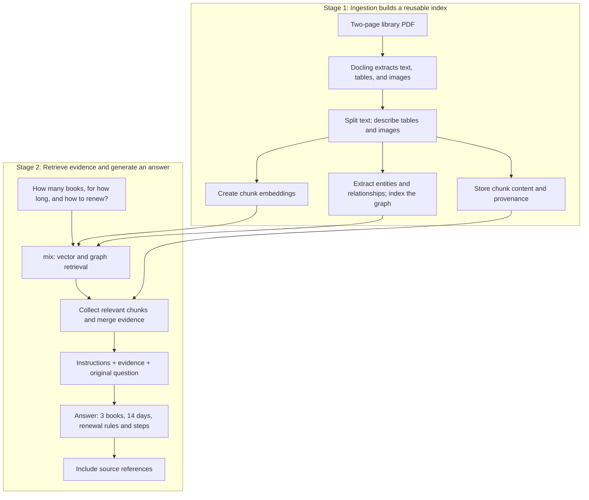
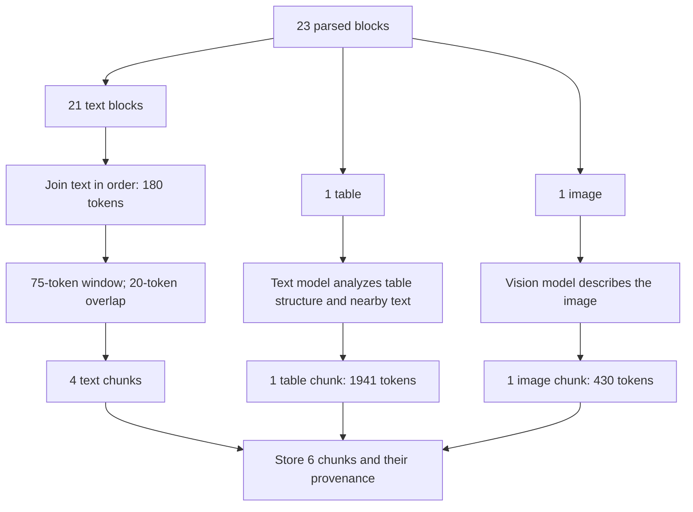
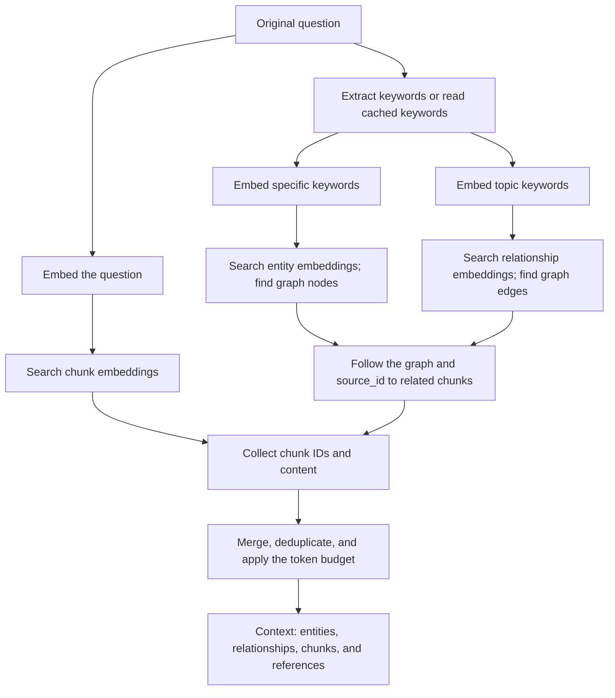
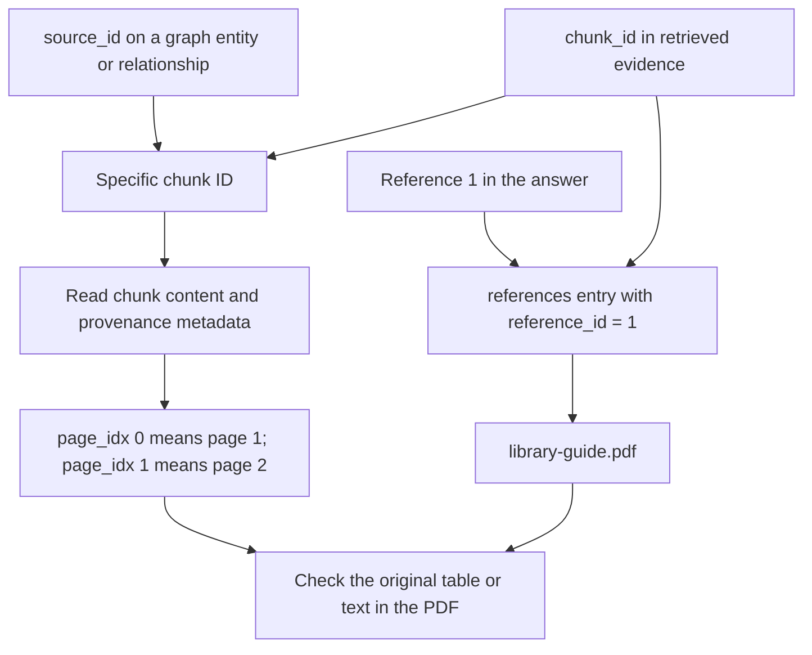
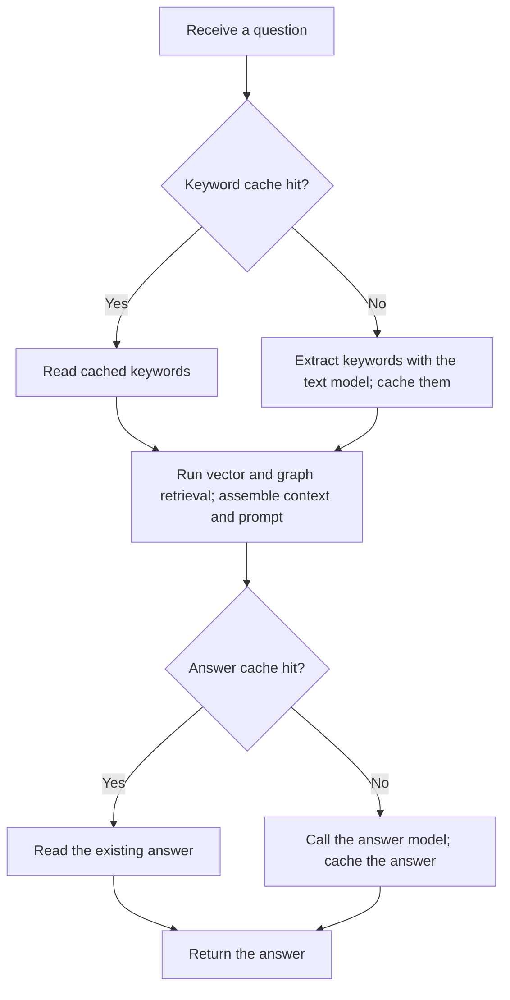

# Library RAG: From a PDF to an Answer You Can Trace

This project uses a two-page [Library Borrowing Guide](data/library-guide.pdf) to show how a system processes text and images, finds information relevant to a question, and asks a model to answer using that evidence. Work through the [Notebook](src/rag_anything_walkthrough.ipynb) to inspect the inputs and outputs at each step.

This is the core idea of RAG, or **retrieval-augmented generation**: **retrieve evidence first, then give that evidence to a model to compose an answer.** Ingestion builds a searchable index. It does not train the answer model or change its parameters.

The counts, chunk IDs, and retrieval results below refer to the English run saved in the Notebook and `outputs/library_rag_storage/`. Rebuilding the index can change model-generated descriptions, the graph, and retrieval results.

## Start with the question

> How many books can a student borrow at a time, for how long, and how can they renew them?

The answer is spread across different parts of the PDF:

| Source | Information | Part of the question it answers |
| --- | --- | --- |
| Table on page 1 | Up to **3 books** at a time; a **14-day** standard loan period | How many books and for how long |
| Text on page 2 | Before the due date, open **My Loans**, find the book, and click **Renew**. If nobody else has reserved it, renew it once for **7 extra days** | How to renew and under what conditions |
| Diagram on page 2 | Check the due date → find the book → click Renew and check the new due date | The sequence of actions |

The system must find and combine these pieces to give a complete answer.

## The full workflow: prepare the material, then answer questions



This diagram shows the main path through a first run. Existing indexes and cached results can be reused; the cache checks are shown later.

| Component | Its role in this project |
| --- | --- |
| **Docling** | Parses the PDF locally into text, table structures, and images |
| **RAGAnything** | Coordinates parsing, multimodal processing, ingestion, and querying |
| **LightRAG** | Splits text, manages chunks, vectors, and the knowledge graph, retrieves evidence, builds context, and invokes the answer model |
| **Text model: `llm`** | Analyzes tables, extracts entities and relationships, extracts query keywords, and generates answers |
| **Vision model: `vision`** | Reads an image and produces a text description |
| **Embedding model: `embed`** | Encodes text as numeric vectors for similarity search |

The Notebook's `calls` list records inputs and outputs from the three model callbacks. It is an observation log in the current kernel. Persistent caches are stored separately on disk.

## 1. Parsing: turn a PDF into typed content

The Notebook calls `rag.parse_document(..., allow_ocr=False)`. This PDF already has a text layer, so OCR is disabled. Docling still analyzes the layout, identifies the table, and extracts the image.

The return values are a document ID, `doc_id`, and a list of parsed blocks, `content_list`. This run contains **23 parsed blocks**:

| Location | Text blocks | Tables | Images |
| --- | ---: | ---: | ---: |
| Page 1 | 10 | 1 | 0 |
| Page 2 | 11 | 0 | 1 |
| Total | **21** | **1** | **1** |

A text block has the following shape. The sentence below illustrates the renewal rule; inspect the Notebook for the exact parsed wording:

```json
{
  "type": "text",
  "text": "If nobody else has reserved the book, you can renew it once for 7 extra days.",
  "page_idx": 1
}
```

`page_idx` is zero-based, so `1` means PDF page 2. A table block stores cell structure in `table_body`. An image block has an `img_path` pointing to the PNG extracted by Docling.

Text blocks can include headings, paragraphs, captions, footers, and page numbers. **Parsed blocks describe the PDF's content and layout. They are not yet the chunks used for retrieval.**

## 2. Chunking: organize the content into searchable units

`rag.insert_content_list(...)` accepts the parsed blocks and handles each content type:



A **token** is a unit used by the model to process text. It is not necessarily one word or one character. This example deliberately uses a small text window so that chunking is easy to observe. It is not a recommended size for every document.

The window advances by `75 - 20 = 55` tokens each time. The following positions are one-based:

| Text chunk | Token range | Length | Overlap with previous chunk |
| --- | --- | ---: | --- |
| 1 | 1–75 | 75 | None |
| 2 | 56–130 | 75 | 56–75 |
| 3 | 111–180 | 70 | 111–130 |
| 4 | 166–180 | 15 | 166–180 |

The final 15-token chunk is a short tail already present in chunk 3, so that last pair shares 15 tokens rather than the full configured 20.

Overlap preserves text near a boundary in two neighboring chunks. This reduces the chance of losing context when a rule is split. For example, the beginning of a renewal instruction may appear near the end of one chunk and be repeated in the next. Token-based splitting does not guarantee complete sentences or respect page boundaries.

**The 75-token limit applies to ordinary text chunks in this run.** Tables and images follow separate processing paths. Their chunks contain structure, contextual information, and model-generated descriptions, so they can be longer. A table description may also include renewal information from nearby text.

These are the stored chunks; IDs are shortened for readability:

| Chunk ID | Type | Tokens | PDF page | Content |
| --- | --- | ---: | --- | --- |
| `chunk-9afabfd0…` | Text | 75 | 1 | Library Borrowing Guide Borrowing and returning books Before borrowing, check that your account is e… |
| `chunk-f74d3981…` | Text | 75 | 1–2 | check each title separately. Return each book on or before its due date. Library Borrowing Guide 1 /… |
| `chunk-b5b66dc4…` | Text | 70 | 2 | ". If nobody else has reserved it, renew once for 7 extra days. If it is reserved, return it by the … |
| `chunk-0bec09cb…` | Text | 15 | 2 | , check the date again. Library Borrowing Guide 2 / 2… |
| `chunk-cf352990…` | Table | 1941 | 1 | 3 books and a 14-day standard loan |
| `chunk-816ab159…` | Image | 430 | 2 | Renewal diagram and visual description |

## 3. Indexing: keep the text and build vectors and a knowledge graph

After saving the chunks, the system builds two complementary ways to find them.

### Embeddings: search by semantic similarity

An embedding model encodes text as a sequence of numbers. This run uses `text-embedding-3-small`; each chunk embedding contains **1536 numbers**. The first text chunk has this stored vector prefix:

```text
chunk-9afabfd0…
→ [-0.0262146, 0.0459900, 0.0384521, -0.0095520, 0.0028915, -0.0240631, …]
```

Only a short prefix is shown; retrieval uses the full vector. An individual number does not mean something readable such as “3 books.” The question is encoded with the same embedding model, and cosine similarity helps identify relevant content. Similarity selects candidates; it does not prove a statement is correct.

Vectors and text are associated through chunk IDs. **Text-vector search returns matching chunk IDs and their content. Graph retrieval uses source IDs to recover related text.** The answer model reads the retrieved text, not the numeric vectors.

This run has **6 chunk embeddings**. Entity and relationship embeddings are stored as well for graph retrieval.

### Knowledge graph: search through entities and their relationships

The text model extracts **entities**, such as borrowing rules or renewal, and **relationships** between them. Entities are graph nodes; relationships are graph edges.

For illustration, the document supports these connections. The exact entity names in a model-generated graph can vary:

| Connection | Fact represented | Supporting evidence |
| --- | --- | --- |
| Student borrowing rules ↔ 3-book limit | A student can borrow up to 3 books at a time | Table chunk `chunk-cf352990…` |
| Student borrowing rules ↔ 14-day loan period | The standard loan period is 14 days | Table chunk `chunk-cf352990…` |
| Renewal ↔ 7 extra days | An eligible renewal extends the loan by 7 days | Text chunk `chunk-f74d3981…` |

The graph preserves `source_id`, allowing extracted knowledge to be traced to supporting chunks. One relationship may have several source chunks, whose IDs are joined with `<SEP>`. Graph descriptions and multimodal descriptions are model-generated interpretations; check the PDF when verifying a specific rule.

An **entity embedding** encodes the entity's meaning, usually its name and description. A **relationship embedding** encodes relationship keywords, the endpoint entities, and a description of the connection. These are text embeddings; a relationship vector is not calculated by subtracting the two entity vectors.

## 4. Retrieval: find the evidence for a question

The Notebook uses `mode="mix"` to retrieve from both text vectors and the knowledge graph. It sets `enable_rerank=False`, so there is no additional reranking stage.

First, the system extracts query keywords or reuses cached keywords. This run produced:

| Keyword group | Extracted keywords | Purpose |
| --- | --- | --- |
| Specific keywords: `low_level` | Student borrowing limit, Books per student, Loan duration, Renewal process | Find relevant entities |
| Topic keywords: `high_level` | Library borrowing policy, Loan period, Book renewal | Find relevant relationships |

Three paths then contribute candidate evidence. This diagram shows data dependencies, not a requirement to make three separate API requests:



For this question, the table chunk supplies **3 books and 14 days**. The renewal text supplies **before the due date, My Loans, no other reservation, one renewal, and 7 extra days**. The image description can reinforce the sequence of actions.

The saved retrieval returned **28 entities, 67 relationships, 6 evidence chunks, and 1 source file**. The material is short, so a query can retrieve much of it. In a larger collection, similarity thresholds, candidate limits, and context budgets restrict the evidence selected.

### Trace an answer back to the source

A reference number, a chunk ID, and a page index identify different things:



To verify “7 extra days,” follow the relevant `source_id` to `chunk-f74d3981…`, read the renewal conditions, and inspect `page_idx=0` with `page_idx_end=1`: this chunk spans PDF pages 1–2, and the renewal clause appears on page 2. To verify “3 books, 14 days,” inspect table chunk `chunk-cf352990…` and page 1.

The answer's `[1]` points to the whole `library-guide.pdf` file. It does not identify a specific chunk by itself. The retrieved chunks come from that same file, so they share `reference_id="1"`.

## 5. Generation: what the answer model actually receives

After retrieval, the system puts the answering instructions and evidence in the `system` message and the original question in the `user` message. The following is a simplified illustration. Notebook section 9 shows the actual `system_prompt` and callback inputs when a new answer is generated.

```text
system:
  Answer using the supplied evidence and cite the sources.
  The context contains retrieved entities, relationships, chunks, and references.
  Evidence excerpts:
    Table: Up to 3 books at a time, with a 14-day standard loan period.
    Text: Before the due date, open My Loans and click Renew.
          If nobody else has reserved the book, renew once for 7 extra days.
  Source 1: library-guide.pdf

user:
  How many books can a student borrow at a time, for how long, and how can they renew them?
```

A complete answer should convey:

> A student can borrow up to 3 books at a time for 14 days. Before the due date, open My Loans, find the book, and click Renew. If nobody else has reserved it, it can be renewed once for 7 extra days. Otherwise, return it by the original due date. After renewing, check the new due date. [1]

This example uses `vlm_enhanced=False`. The answer stage can use the image's text description, but it does not send the original image again. The vision model processed that image during ingestion.

The Notebook exposes four observation points:

| Call | What it returns | Generates a final answer? |
| --- | --- | --- |
| `rag.lightrag.aquery_data(...)` | Structured keywords, entities, relationships, chunks, and references | No |
| `rag.aquery(..., only_need_context=True)` | Assembled evidence context | No |
| `rag.aquery(..., only_need_prompt=True)` | A preview of the system prompt and user question | No |
| `rag.aquery(..., stream=False)` | A complete answer | Yes, or it returns a cached answer |

**These are independent calls, each of which performs retrieval.** A later section does not simply continue from the variable printed in the previous section. The first three omit final answer generation but may still call the keyword and embedding models. A normal application needs only the last call for one complete question-answer interaction.

## 6. Caching: what a repeated question can reuse

The stored index supports later questions. Model-response caches can additionally reuse particular results. For a normal `mix` query in the installed LightRAG 1.4.16, the checks occur in this order:



**The answer cache is checked after retrieval and context construction.** A hit skips final answer generation; query embedding calls can still occur.

| Reusable data | Stored in | Main work it can avoid |
| --- | --- | --- |
| Completed document index | Document status, chunks, vectors, and graph storage | Re-ingesting the same completed document |
| Extraction cache: `extract` | `kv_store_llm_response_cache.json` | Repeating an identical extraction-model task |
| Keyword cache: `keywords` | The same cache file | Extracting query keywords again |
| Answer cache: `query` | The same cache file | Generating the final answer again |

The saved run contains 12 `extract`, 1 `keywords`, and 1 `query` records, including `mix:keywords:2545045a3a628a91045c61f7510377d8` and `mix:query:4f6e6bd69b9f6690531953c5de393b03`. These records show that results were written to the cache. A stored entry alone is not evidence that a later query hit it.

Rerun section 9 in the same kernel to observe the `Query cache hit` log and the newly added entries in `calls`. An answer-cache hit produces no new answer-model callback record. Check whether an `embed` call was still added.

Cache keys are derived from the question and parameters; the system does not use vector similarity to choose a previous answer. Paraphrasing a question does not guarantee a hit. One embedding request can also contain several inputs, such as the question and both keyword groups, so one API call does not necessarily mean one vector.

Two distinctions matter when rerunning:

- **Restarting the kernel does not clear disk caches.** This tutorial parses the PDF before the new `RAGAnything` instance initializes its parse cache, so the PDF is parsed again. Stored indexes and model-response caches can still be reused afterward.
- **A cached answer is not automatically the latest answer.** The current answer-cache key depends on the question and retrieval parameters, but does not directly include the index contents or model name. To observe a fresh run, or when changing the material, embedding model, or vector dimensions, choose a new `storage_dir` to avoid mixing old indexes and cached results.

## Follow the process in the Notebook

| Notebook section | What to observe |
| --- | --- |
| 1–3: Configuration, callbacks, and setup | PDF and storage paths; `llm`, `vision`, and `embed`; the 75/20 chunking settings |
| 4: Parse the PDF | 23 parsed blocks, table cells, and the extracted image |
| 5: Ingest the content | `fully_processed`, table analysis, image descriptions, and model calls |
| 6: Read the index | 6 chunks, vector samples, and graph `source_id` fields |
| 7: Retrieve evidence | Keywords, entities, relationships, chunk IDs, and file references |
| 8: Inspect context and prompts | How retrieved information becomes model input |
| 9: Generate an answer | The answer and, when generated, the actual system/user inputs; cache behavior |
| 10: Finalize and reuse storage | Persistence and reuse when opening the same directory |

The lesson includes a diagram at each major stage, focused observation goals, expandable self-check answers, and a diagnostic table for revisiting confusing concepts. Long implementation details and outputs are collapsed by default.

The graph preview in section 6 uses `max_nodes=30`. It is a partial view, not a count of all nodes in the stored graph. Optional experiments are disabled by default. Enable them to compare `naive` with `mix`, or text-only answering with original-image enhancement.

## Run the project

Run these commands from the project root. The project uses `uv` and Python 3.14.

```sh
uv sync --locked
cp -n src/.env.example src/.env
```

Set `OPENAI_API_KEY` in `src/.env`, then start JupyterLab:

```sh
uv run --env-file src/.env jupyter lab
```

Open `src/rag_anything_walkthrough.ipynb`, select the Python 3 kernel, and run the cells in order. Model names, the API base URL, and vector dimensions come from `src/.env`. The Notebook searches upward for the project root containing `pyproject.toml`, so its resource paths work when the kernel starts inside `src/` as well.

With the API key left empty, you can run through PDF parsing. Docling parses locally and may download layout and table-recognition model files on its first run. Text generation, image understanding, and embeddings use cloud APIs. Ingestion and querying send the example content to those APIs and incur usage charges.

## Project files and generated artifacts

| Path | Purpose |
| --- | --- |
| `data/library-guide.pdf` | The two-page English source document |
| `data/build_library_guide.py` | English source for regenerating the PDF and renewal diagram |
| `src/rag_anything_walkthrough.ipynb` | The executable lesson, organized around the processing steps |
| `src/.env.example` | Example model and API configuration |
| `src/.env` | Actual local settings and API key; not committed to Git |
| `outputs/parsed/` | Docling exports and extracted images |
| `outputs/library_rag_storage/` | Persistent indexes and caches for this example |

To rebuild the source PDF, run this optional command from the project root. It supplies ReportLab for the generator without changing the project's dependency declarations:

```sh
uv run --with reportlab python data/build_library_guide.py
```

Useful files to inspect inside the index directory:

| File | Contents |
| --- | --- |
| `kv_store_doc_status.json` | Document-processing status and the document's chunk list |
| `kv_store_text_chunks.json` | Chunk content and metadata such as source file and page index |
| `vdb_chunks.json` | Chunk embeddings and their associated IDs |
| `vdb_entities.json`, `vdb_relationships.json` | Entity and relationship vector indexes |
| `graph_chunk_entity_relation.graphml` | Graph nodes, relationships, and provenance links |
| `kv_store_llm_response_cache.json` | Extraction, keyword, and answer caches |

Finish by running `await rag.finalize_storages()`. After restarting the kernel, run the cells in order to reopen the same indexes and caches. The vector store uses float16 compression, so stored vector values may differ slightly from the original values recorded by the embedding callback.

## Terminology to keep straight

| Term | Meaning in this project |
| --- | --- |
| Parsed block | A typed piece of PDF content, such as a paragraph, table, or image |
| Chunk | A unit of text stored for retrieval; it can contain original text or a multimodal description |
| Ingestion | Processing source material and storing reusable indexes |
| Embedding | A numeric representation of text used for similarity search |
| Entity / relationship | A graph node representing a concept or object / an edge describing a connection |
| Retrieval | Selecting evidence relevant to a question |
| Context | The selected evidence assembled for the answer model |
| Prompt | The instructions and inputs supplied to a model |
| Provenance | Information linking a result to its supporting chunks and source document |
| Cache hit | Reusing a stored result instead of repeating the corresponding computation |

Further reading: [RAGAnything](https://github.com/HKUDS/RAG-Anything), [LightRAG](https://github.com/HKUDS/LightRAG), and [Docling model artifacts](https://docling-project.github.io/docling/usage/advanced_options/).
